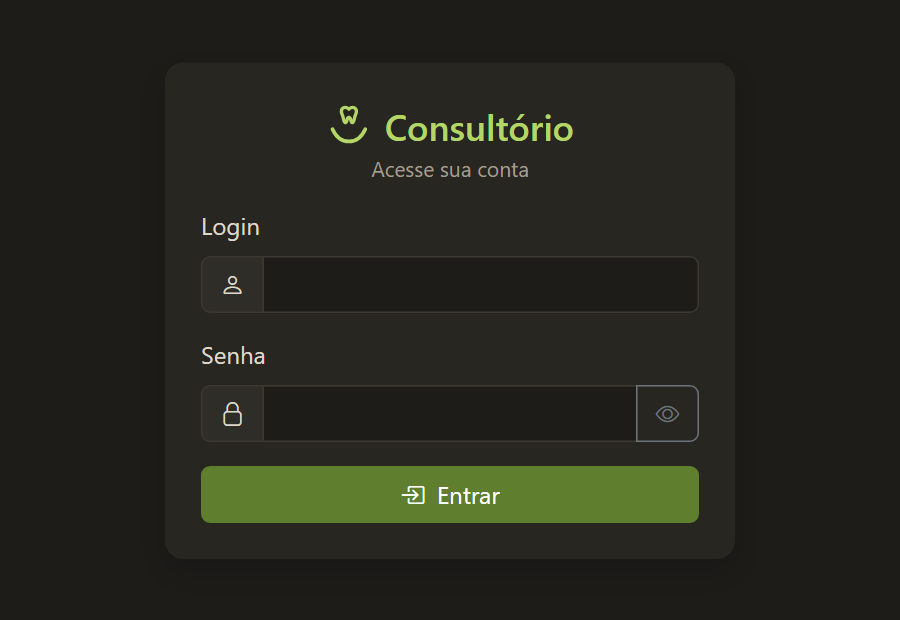
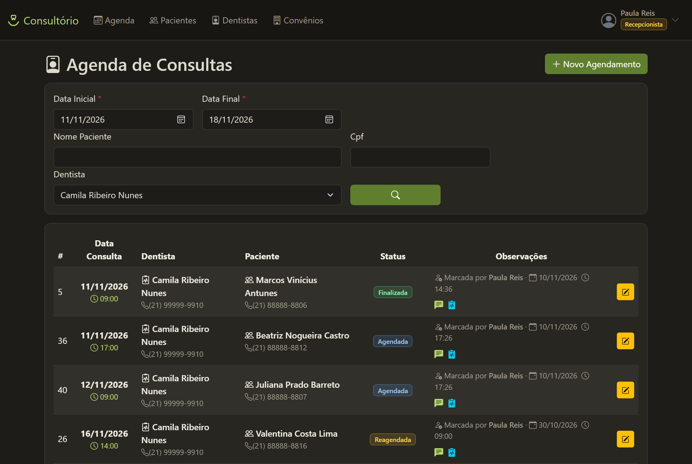
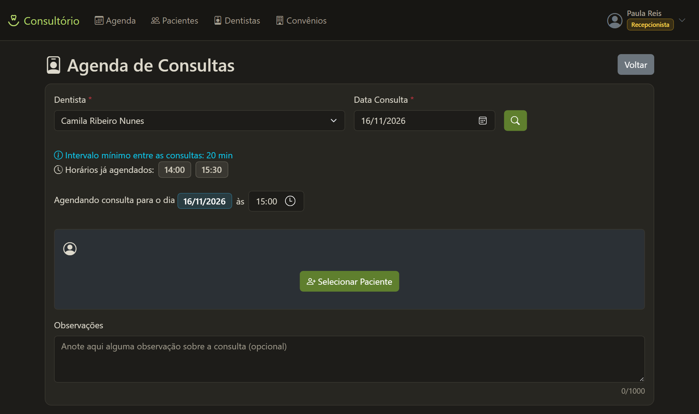
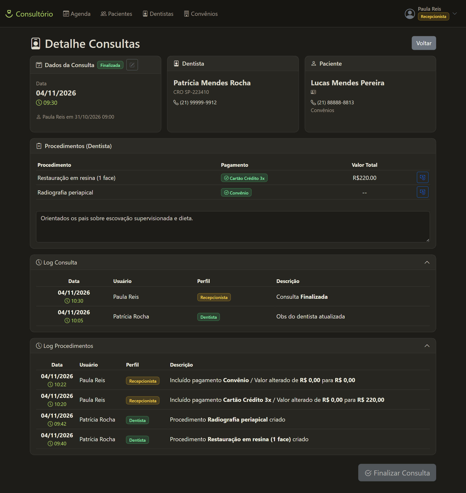
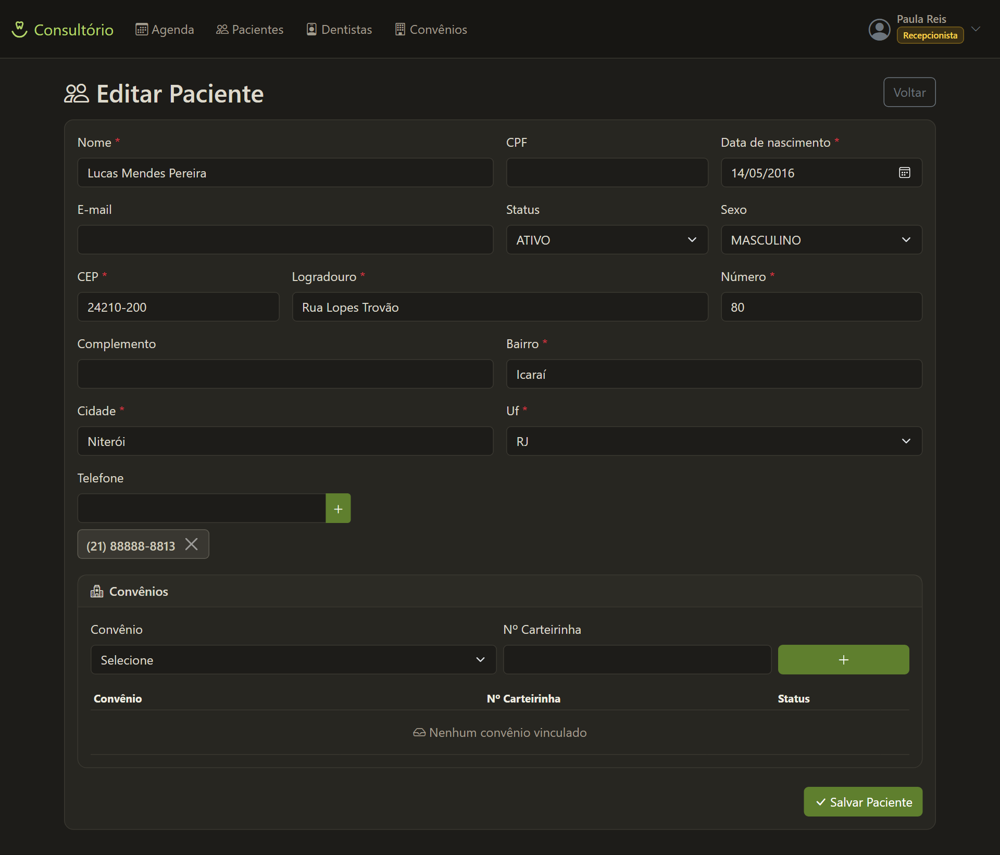

# Consultório Odontológico — Front-end (Angular)

Sistema web para gestão de um consultório odontológico: **agenda de consultas, pacientes, dentistas, convênios, procedimentos e acerto financeiro por consulta**, com **controle de acesso por perfil** e histórico (log) de tudo o que é alterado.

Este repositório contém o **front-end em Angular**. A API (.NET 8 + PostgreSQL) fica em um repositório privado; veja a seção [API](#api-repositório-privado).


## Telas

> Todos os dados exibidos nos prints são fictícios.

**Login**



**Agenda de consultas** — busca por período, paciente, CPF e dentista, com o status de cada consulta e quem a marcou.



**Marcação de consulta** — mostra os horários já ocupados do dentista e o intervalo mínimo entre consultas.



**Detalhe da consulta** — procedimentos e pagamento de cada um, observação do dentista e o histórico (log) de tudo o que foi feito.



**Cadastro de paciente** — endereço, telefones e convênios vinculados.



## Funcionalidades

- **Login com JWT** e sessão do usuário; rotas e menu respeitam o perfil de acesso.
- **Agenda:** busca por período, paciente, CPF e dentista; marcação de consulta mostrando os horários já ocupados do dentista; reagendamento, cancelamentos e ausências (paciente e dentista).
- **Detalhe da consulta:**
  - o dentista inclui procedimentos e a observação técnica;
  - a recepção acerta o pagamento de cada procedimento e finaliza a consulta;
  - histórico (log) da consulta e dos procedimentos, com usuário e data/hora.
- **Pacientes:** cadastro com endereço (busca de CEP pelo ViaCEP), vários telefones, CPF validado (opcional, para crianças) e convênios vinculados com número de carteirinha.
- **Dentistas:** CRO, telefones e especialidades.
- **Convênios:** razão social, registro ANS, CNPJ (aceita também o novo formato alfanumérico), telefones, e-mails e sites.
- **Usuários:** cadastro e manutenção de usuários por perfil.

## Perfis de acesso

| Perfil | O que pode fazer |
|---|---|
| **Administrador** | Tudo no sistema. |
| **Administração Clínica** | Semelhante ao administrador, mas nas mãos do responsável pela clínica; separa nos logs o que é do desenvolvedor e o que é da clínica. |
| **Recepcionista** | Marcar, reagendar e cancelar consultas; acertar o pagamento ao final da consulta; criar e atualizar pacientes; atualizar o cadastro dos dentistas. |
| **Dentista** | Incluir procedimentos e observações técnicas nas consultas. |

O front esconde o que o perfil não pode usar (`perfilGuard` nas rotas e menu condicional). A API exige usuário autenticado em todos os endpoints e restringe por perfil os mais sensíveis (por exemplo, cadastro de dentista e configurações do sistema).

## Regras de negócio

- **Intervalo mínimo entre consultas** do mesmo dentista (padrão de 20 minutos, configurável no banco), na marcação e no reagendamento.
- Não é possível marcar ou reagendar para uma data/hora no passado.
- Na tela, **alterar o status** da consulta (cancelar, reagendar, ausência) só é liberado depois que há procedimento com pagamento acertado; **finalizar** exige que todos os procedimentos estejam pagos.
- Formas de pagamento com valor (dinheiro, Pix, débito, crédito em até 6x) e sem valor (convênio, cortesia).
- Toda alteração de status, observação e procedimento gera **log** com o usuário responsável.

## Tecnologias e arquitetura do front

- **Angular 21**, componentes *standalone*, *signals* e injeção com `inject()`.
- **TypeScript**, **RxJS**, **Bootstrap 5** + Bootstrap Icons, **ngx-mask** (máscaras de CPF, CNPJ, telefone e CEP).
- **Rotas** com `authGuard` (exige login) e `perfilGuard` (exige o perfil da rota).
- **`HttpInterceptor`** que anexa o token JWT (`Bearer`) em todas as chamadas à API.
- **Services** por recurso (paciente, dentista, consulta, convênio...), com **models e DTOs tipados**.
- **Utilitários de validação** próprios: CPF, CNPJ (numérico e alfanumérico), e-mail e data de nascimento.
- Tema escuro próprio sobre o Bootstrap (variáveis CSS), em `src/styles.scss`.

```text
src/app/
├── component/   # telas: agenda, paciente, dentista, convênio, usuário, login e componentes compartilhados (modais)
├── services/    # chamadas HTTP e sessão/autenticação
├── guards/      # authGuard e perfilGuard
├── interceptors/
├── models/ e dto/
├── util/        # validações e formatações
└── layout/      # menu e estrutura da página
```

## API (repositório privado)

A API que atende este front é um projeto meu à parte, em repositório privado:

- **.NET 8**, dividida em camadas (`Api`, `Application`, `Domain`, `Infra`), com serviços e DTOs na `Application` e repositórios e mapeamentos na `Infra`;
- **PostgreSQL**, com **EF Core** e **Dapper** nas consultas da agenda;
- Autenticação **JWT** com senhas em **BCrypt** e autorização por perfil;
- **Swagger** para documentação dos endpoints.

Se quiser conhecer o código da API, é só me chamar.

## Como rodar

O sistema depende da API, então o front **não funciona sozinho**: sem ela, o login e as telas não carregam. Os prints acima mostram o sistema funcionando.

Com a API rodando em `https://localhost:7004/`:

```bash
npm install
npm start
```

Acesse `http://localhost:4200`. A URL da API em desenvolvimento fica em `src/environments/environment.development.ts` (a API precisa liberar o CORS para `http://localhost:4200`).

Pré-requisito: Node.js em versão compatível com o Angular 21.

## Autor

**Heberton Maia** — desenvolvedor .NET.

[LinkedIn](https://www.linkedin.com/in/heberton-maia-dev/)
